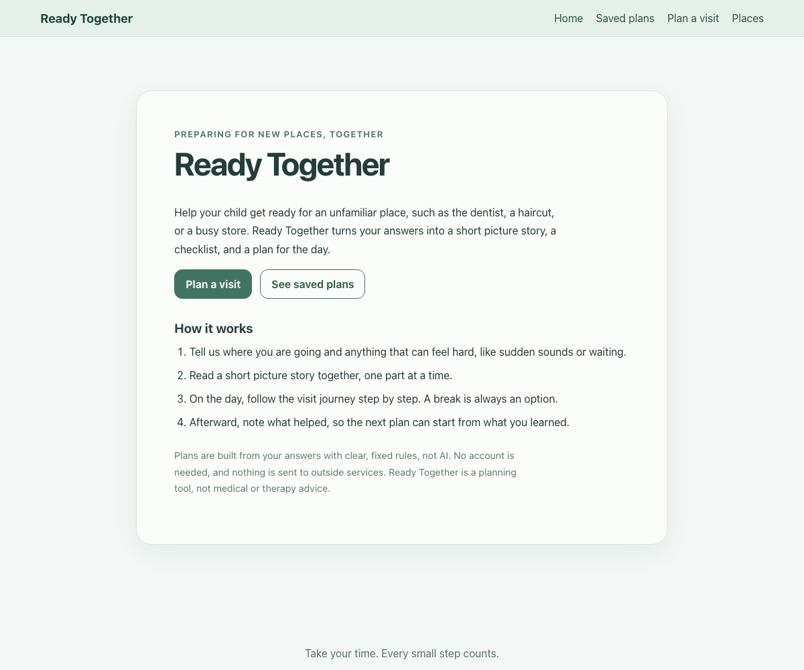
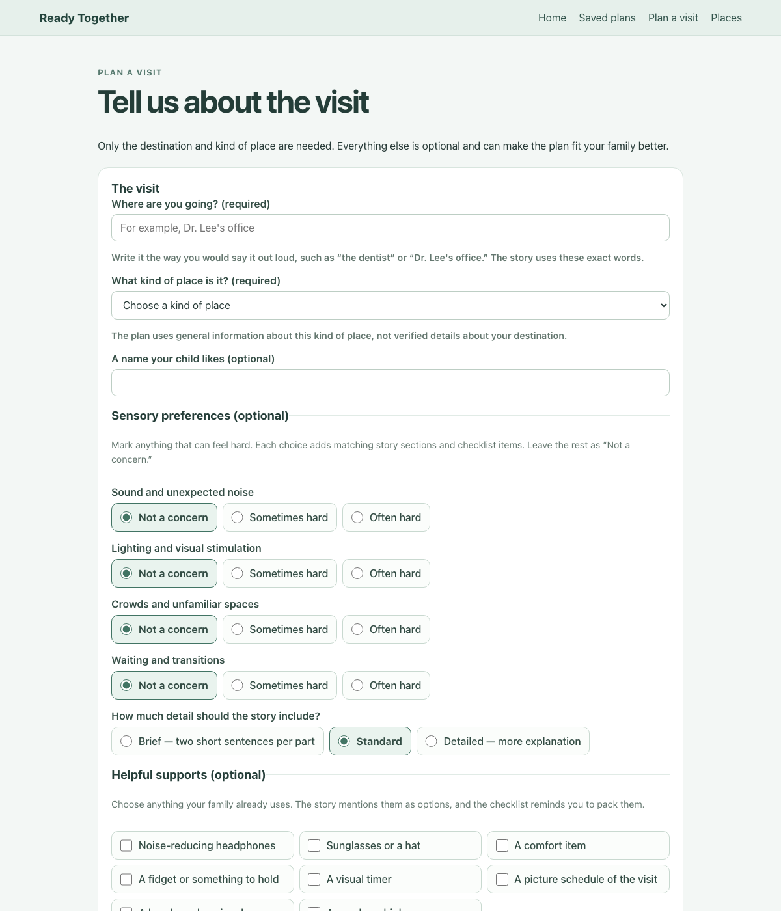
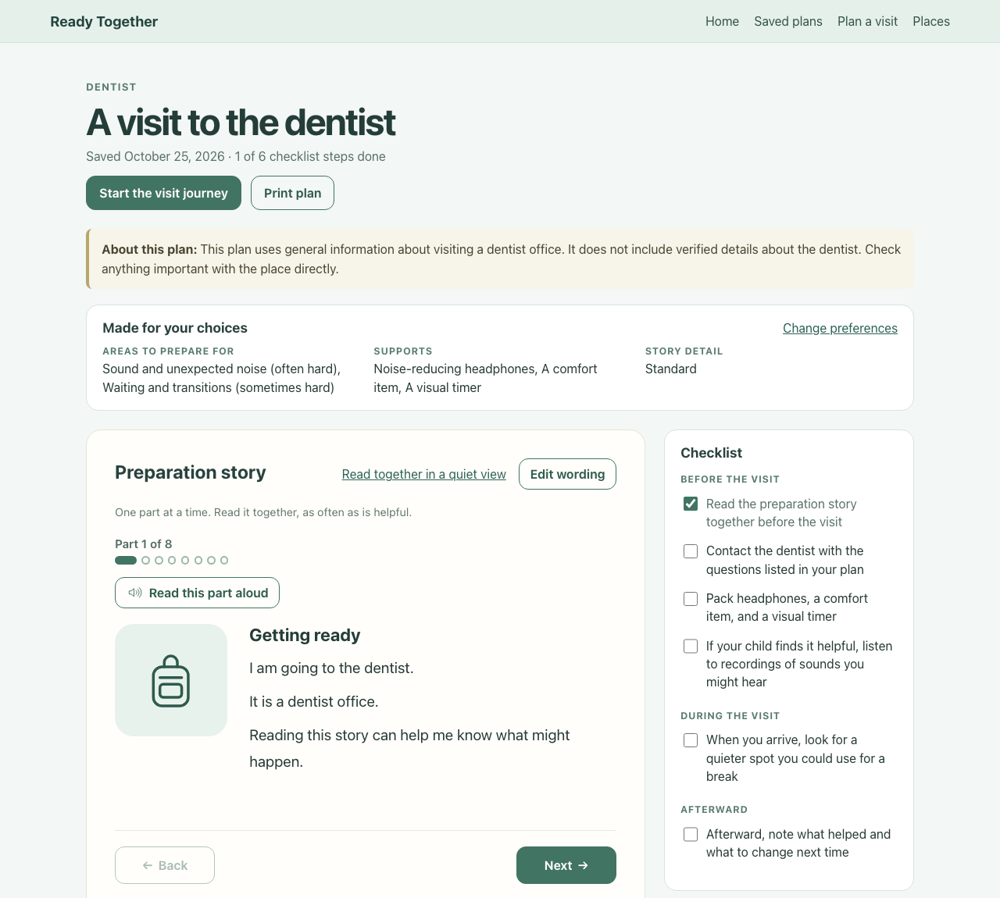
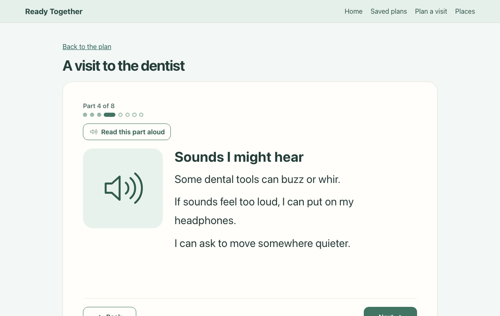
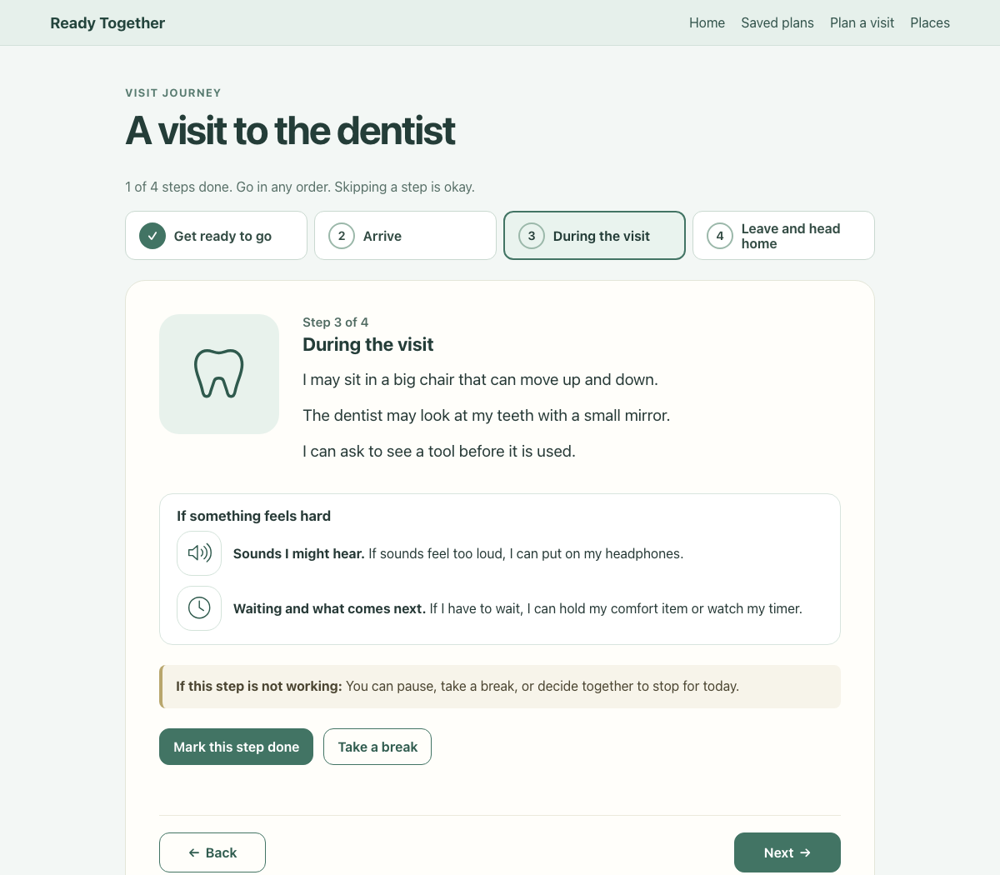
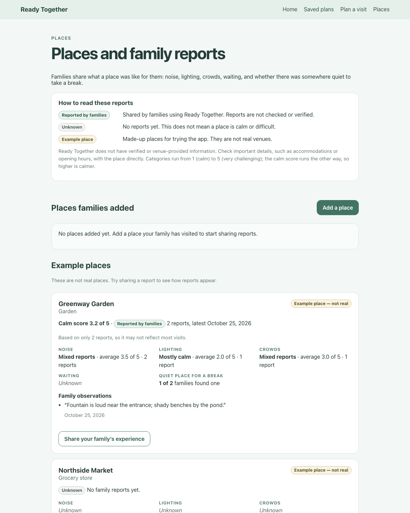
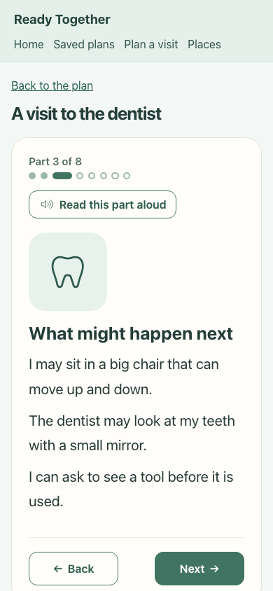

# Ready Together

Ready Together helps families prepare sensory-sensitive children for unfamiliar
places, such as a dentist visit, a haircut, or a busy store. A caregiver
describes the visit and anything that can feel hard. The app then builds a
short picture story, a checklist, and a step-by-step plan for the day, and
gives the family space afterward to note what helped.



Ready Together is a planning tool. It does not diagnose anything, give medical
or therapy advice, or promise how a visit will go.

## The problem

New places can be hard for children who are sensitive to sound, light,
crowds, or waiting. Many families prepare by talking a visit through ahead of
time, and preparation stories and picture schedules are common ways to do that.
Making them by hand for every visit takes time, and general advice does not
fit every child: a child who finds sudden sounds hard needs different
preparation from a child who finds waiting hard.

Ready Together makes that preparation quick and specific to each family, while
staying honest that it uses general information about kinds of places, not
verified facts about a particular venue.

## Who it is for

Parents and caregivers preparing a child for an unfamiliar place. No account
is needed, and the child's name is optional.

## How it works

1. **Plan the visit.** Enter where you are going and the kind of place. Then,
   optionally, mark which areas can feel hard (sound, lighting, crowds,
   waiting), choose how much detail the story should have, and pick the
   supports your family uses.
2. **Read the story together.** The story is shown one part at a time, each
   with a simple picture, so there is less to take in at once. There is a quiet
   view with larger text and an optional read-aloud button.
3. **Follow the visit journey.** On the day, four steps (get ready, arrive,
   during the visit, leave) show what to do, the family's own coping ideas, and
   a break button that returns to the same step.
4. **Note what helped.** Afterward, record which parts and supports helped
   and what to change. A later plan can show these notes, but only if the
   caregiver chooses that.

| Plan a visit | The plan |
| --- | --- |
|  |  |

| Story, one part at a time | Visit journey |
| --- | --- |
|  |  |

| Places and family reports | On a phone |
| --- | --- |
|  |  |

## Features

- **Personalized plans.** Two families going to the same dentist get
  different story parts, checklists, and questions to ask, depending on what
  they chose. Every personalized part shows why it was included, such as
  "You marked sound and unexpected noise as often hard."
- **Picture story.** One part at a time, with Back and Next, line drawings for
  each part and support, a quiet view, read aloud (browser speech), and a
  print layout that works as a paper picture schedule.
- **Editing.** Caregivers can rewrite any sentence. Edited parts are marked
  "You edited this part." Preferences can be changed later to rebuild the
  plan, keeping checklist ticks and journey progress where they still apply.
- **Checklist.** Up to eight items chosen by rules, grouped into before,
  during, and after the visit, with ticks saved as you go.
- **Visit journey.** Four day-of steps with linked checklist items, coping
  ideas, an "if this step is not working" note, and a calm break.
- **Calm break.** An optional breathing activity that can be paused at any
  time and returns to the same journey step.
- **Reflection.** Optional after-visit notes, which a new plan can show and
  copy preferences from, only when the caregiver asks.
- **Places and family reports.** Families can add places and report noise,
  lighting, crowds, waiting, whether there was a quiet space, and a short
  note. Every place shows where its information came from (see
  [Trustworthy place information](#trustworthy-place-information)).

## How personalization works

Personalization is **rule-based**, not AI. The same answers always produce the
same plan, and every rule can be read and tested.

- **`server/planContent.js`** holds what the app can say: four sensory areas,
  eight supports, eight kinds of place, eleven checklist rules, and the four
  journey steps. Descriptions of places use hedged words such as "may" and
  "sometimes", and a test checks this.
- **`server/personalization.js`** decides what to include:
  - `normalizeProfile()` fills in defaults for anything left blank and rejects
    values it does not recognize.
  - `buildPlan()` adds a story part for each area marked "sometimes" or
    "often", and an extra sentence for "often". Inside each part it mentions
    the family's own supports that help with that area, such as "If sounds feel
    too loud, I can put on my headphones."
  - The detail level limits sentences per part (2, 3, or 4).
  - Checklist rules each say when they apply. If more than eight apply, the
    lowest-priority ones are dropped, so choosing everything still gives a
    short list.
  - It also builds questions to ask the place, and optional ideas (for
    example, "Some families find noise-reducing headphones helpful") for marked
    areas that have no chosen support.
  - `buildJourney()` builds the day-of journey from the saved plan.

Reflections are stored and shown back to the caregiver. They do not change the
rules, and the app does not build a profile of the child.

## Trustworthy place information

- Nothing about a place is invented. The three example places are labeled
  "Example place, not real" and start with no reports.
- Each place says where its information came from: **Reported by families**
  (with report counts and the latest date) or **Unknown** (no reports yet).
  Ready Together has no verified or venue-provided information, and the page
  says so.
- "Not sure" answers are left out of averages. The report form starts at "Not
  sure", so an untouched form records nothing.
- The page warns when a score is based on fewer than three reports, or when
  the latest report is more than a year old.

## Architecture

- **Client:** React 19, React Router, and Vite (`client/`). No UI library; the
  pictures are hand-written SVG.
- **Server:** Node.js and Express 5 (`server/`), with a JSON API and server-side
  validation of every input.
- **Database:** SQLite through better-sqlite3, stored in `.data/app.sqlite`.
  Numbered migrations in `server/database.js` upgrade older databases without
  losing saved plans or ratings.
- **Tests:** Node's built-in test runner for the server, and a browser test
  that drives headless Chrome through the DevTools protocol.

See [docs/HOW_IT_WORKS.md](docs/HOW_IT_WORKS.md) for a guide to the code and
[APP_COMPONENT_TREE.md](APP_COMPONENT_TREE.md) for the file layout.

## Run locally

Requires Node.js 20 or later. From the repository root:

```bash
npm install
npm --prefix client install
npm run dev
```

Open http://localhost:5173. The API runs on port 3001 and is proxied through
Vite. No API keys or accounts are needed.

## Testing

```bash
npm test               # server tests: personalization, API, database migrations, places
npm run lint           # oxlint
npm run build          # production build of the client
npm run test:browser   # end-to-end test in headless Chrome
```

`npm run test:browser` starts its own API and Vite servers with a throwaway
database, so it never touches your saved plans. It fills in the form, reads
the story with the keyboard only, follows the journey, takes a break, checks
a failed save, edits and rebuilds a plan, records a reflection, reports on a
place, and makes a second plan with different preferences to confirm its
content changes. It needs Google Chrome; set `CHROME_PATH` if Chrome is not in
the default macOS location.

## Privacy

- Everything is stored in the local SQLite file `.data/app.sqlite`, which Git
  ignores. There are no accounts, analytics, or outside services.
- Only the destination and kind of place are required. The child's name,
  photos, preferences, and notes are optional.
- Read aloud uses the browser's built-in speech. Most voices run on the
  device, but some browsers offer online voices.
- The server has no sign-in. Anyone who can open the app can see every plan
  on it, so it is meant for one family or a supervised demo, not public
  hosting.

## Known limitations

- Story content is written for English and covers eight kinds of place. It is
  general information, not facts about a specific venue.
- There is no way to delete a plan or a place report from the app yet.
- Place reports are not moderated or verified.
- Photos are stored inside the database, so there are limits of four photos
  and 2 MB each.
- The app has not yet been tested with families. Accessibility follows WCAG
  2.2 AA practices (labels, keyboard use, visible focus, reduced motion, text
  as well as color) and keyboard use is tested automatically, but it has not
  had a formal accessibility audit or screen reader testing with users.
- The browser test runs at desktop size. Phone layouts were checked with
  screenshots.

## How AI was used

The app itself does not use AI or a language model. See [AI_LOG.md](AI_LOG.md)
for how AI coding assistants were used to build it.
